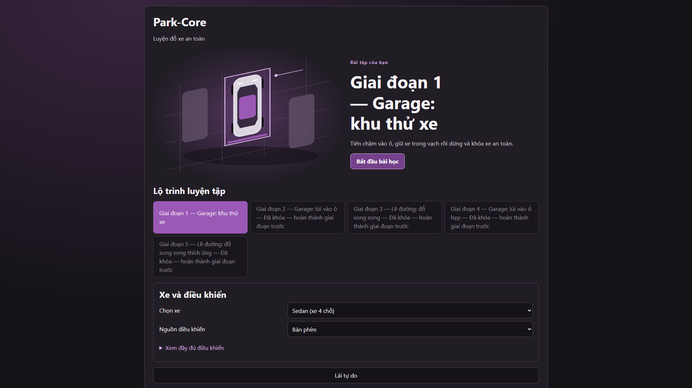
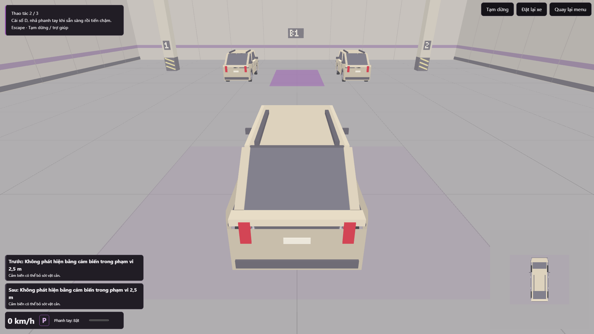
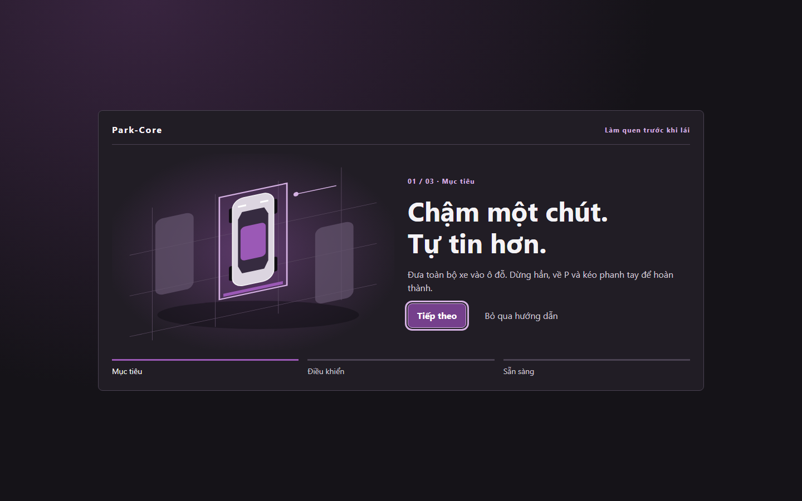
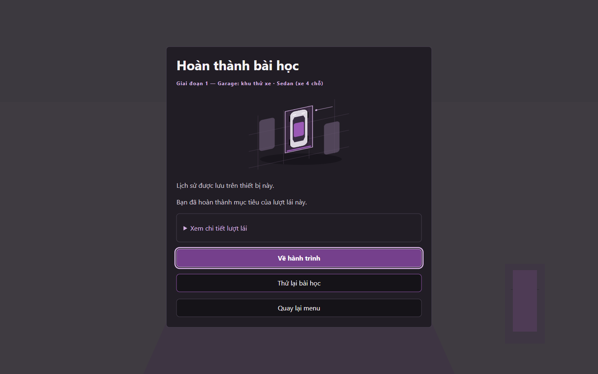

# Park-Core

[](https://www.typescriptlang.org/)
[](https://vite.dev/)
[](https://threejs.org/)
[](https://pmndrs.github.io/cannon-es/)
[](LICENSE)

Park-Core is a browser-based 3D parking simulator prototype for practicing
low-speed maneuvers and spatial awareness. Its learner-facing interface is in
Vietnamese.





[Original asset pictures, measurements and licensing](docs/phase-8-asset-catalog.md).

## Features & Modules

- **Guided lessons:** Five authored parking lessons with checkpoint guidance,
  parking evaluation, attempt recaps, and success-only stage progression.
- **Tutorial-first interface:** Illustrated lesson goals, a stable driving
  coach, paused settings, and constructive recaps with expandable metrics.
- **Vehicles and scenery:** Distinct original Sedan/CUV artwork, cockpits,
  roadside and garage environments, and visible parked lesson vehicles.
  Free drive remains a separate garage sandbox.
- **Driving views:** Driver and chase cameras, mirrors, an overhead view, and
  trajectory guidance.
- **Input:** Keyboard controls and calibrated Gamepad API / simulation-wheel
  input.
- **Parking sensors:** Front and rear proximity readings presented in the HUD.
- **Local progress:** Settings, stage progress, and completed-attempt history
  persist in the browser.
- **Source areas:** `src/app.ts` and `src/contracts.ts` coordinate typed runtime
  state; `src/vehicle` implements vehicle physics; `src/world` defines
  environments; `src/render` and `src/views` handle rendering and cameras;
  `src/input`, `src/lessons`, `src/sensors`, `src/storage`, and `src/ui`
  implement controls, lesson logic, proximity data, persistence, and interface.
- **Performance benchmark:** `/benchmark.html` is a standalone page with four
  fixed vehicle/view cases and JSON report export. The approved target is
  1440p at 60 Hz (p95 frame time <=17.5 ms, mean >=57 FPS, and zero loss);
  this is a benchmark target, not a measured performance guarantee.

## Learning Experience



*A skippable, replayable introduction teaches the goal before the first drive.
The updated Stage 1 capture above shows original CUVs and garage artwork;
chase and overhead views were explicitly enabled. Settings stay out of the
driving HUD.*



*A real completed attempt: the outcome leads, detailed metrics remain available,
and returning to the journey recommends the next unlocked lesson.*

## Tech Stack

- **TypeScript** for application logic and typed contracts.
- **Vite** for development and production builds.
- **Three.js** for 3D rendering and **Cannon-es** for vehicle physics.
- **Vanilla HTML/CSS DOM** for the learner-facing interface.
- **Vitest** for unit tests and **Playwright** for Chromium browser and
  production checks.

## Developer Setup

**Prerequisite:** Node.js `^22.22.2 || ^24.15.0 || >=26.0.0`.

Install dependencies and start the local development server:

```powershell
npm ci
npm run dev
```

Run the unit tests, type check, and production build:

```powershell
npm test
npm run typecheck
npm run build
```

Browser automation uses Chromium. Install it once, then run browser checks:

```powershell
npx playwright install chromium
npm run test:browser
```

After building, run `npm run test:production` to serve and check the production
bundle. Use `npm run preview` to preview a build locally.

## Controls

Keyboard is selected by default:

- `W` / `Up`: throttle; `S` / `Down`: brake.
- `A` / `D` or `Left` / `Right`: steer; mouse: look around.
- Hold the brake and press `1` / `2` / `3` / `4` to select `P` / `R` / `N` /
  `D`.
- `Space`: parking brake; `Q` / `E`: indicators; `F`: acknowledge the current
  lesson step (only accepted while stopped); `Escape`: pause.
- `1`-`4`, `Space`, `Q` / `E` and `F` work in both Keyboard and Gamepad input
  modes while the simulation canvas is focused. Throttle, brake, and steering
  stay source-specific.

For a gamepad or simulation wheel, select the Gamepad input source and complete
the in-app calibration before starting or resuming a session.

## Deployment

The app is published at [park-core.nguyenviettung.id.vn](https://park-core.nguyenviettung.id.vn/)
through GitHub Pages. The Pages workflow validates pull requests and pushes to
`main`; a passing run on `main` deploys the production build. It can also be
started manually from GitHub Actions on `main`.

The repository owner configures GitHub Pages to use GitHub Actions and manages
the custom-domain verification, DNS record, and HTTPS certificate. For a
release, merge to `main` or run the workflow manually, then verify the Actions
run and load the deployed app. To recover a deployment, restore a known-good
change through `main` so it passes the same checks and redeploys.

## Prototype Limits

The simulator, scenarios, and generated 3D assets are prototypes. Software
checks do not establish instructor approval, supported-hardware compatibility,
learner competence, or training readiness. The simulator is not a substitute
for qualified instruction or supervised real-world practice.

## Project Documentation

- [Technical design](docs/tech-design.md)
- [Detailed design](docs/detail-design.md)
- [Implementation roadmap and phase documents](docs/implementation-plan.md)
- [Phase 3 physics measurements](docs/phase-3-measurements.md)
- [Asset pipeline and provenance](docs/asset-pipeline.md)
- [Phase 8 illustrated asset catalog](docs/phase-8-asset-catalog.md)
- [Phase 7 UI/UX design and verification](docs/phase-7-ui-ux-improve.md)
- [Production-readiness change history](PRODUCTION-READINESS-REVIEW.md)

## License

Application code, functional tooling and documentation are
[MIT-licensed](LICENSE). New Phase 8 3D artwork, its
[creative source definitions](tools/asset-designs/LICENSE) and
[artwork images](docs/images/phase-8/LICENSE) use
[CC BY-NC 4.0](public/assets/LICENSE): free noncommercial sharing/adaptation
with attribution, not commercial use. The artwork is source-available, not
OSI-open-source. Earlier MIT grants remain valid; third-party dependencies
and tools retain their own licenses.
