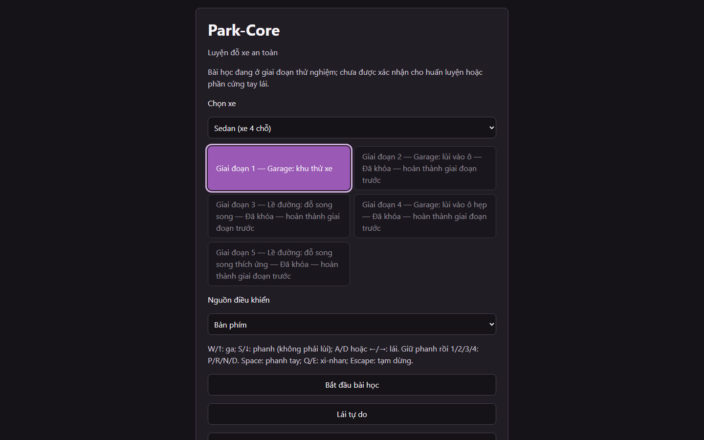

# Park-Core

[](https://www.typescriptlang.org/)
[](https://vite.dev/)
[](https://threejs.org/)
[](https://pmndrs.github.io/cannon-es/)
[](LICENSE)

Park-Core is a browser-based 3D parking simulator prototype for practicing
low-speed maneuvers and spatial awareness. Its learner-facing interface is in
Vietnamese.



## What it includes

- Five guided parking lessons with measured outcomes, attempt recaps, and
  success-only stage progression.
- A separate free-drive sandbox, Sedan and CUV prototypes, and roadside and
  garage environments.
- First- and third-person views, mirrors, an overhead view, and proximity
  sensors.
- Keyboard and calibrated Gamepad API / simulation-wheel input.
- Progress, settings, and completed-attempt history saved locally in the
  browser.

## Performance benchmark

`/benchmark.html` is a separate entry (not the learner app) that runs four fixed
cases (Sedan/CUV, driver/chase; 10 s warm-up + 60 s each) and exports JSON. Use a
focused 100%-zoom window on a 60 Hz display at a 2560x1440 drawing buffer. Target:
p95 <=17.5 ms, mean >=57 FPS, zero loss. Reference-hardware results are pending.
Full-duration measurement and JSON export are verified manually on this page,
not in CI. Automated checks retain benchmark setup/asset smoke tests, a short
Chromium resize-interruption test, and unit coverage for metrics and export.
This separation does not fix the unresolved local Firefox timestamp issue.

## Run locally

**Prerequisite:** Node.js `^22.22.2 || ^24.15.0 || >=26.0.0`.

```powershell
npm ci
npm run dev
```

Open the local URL printed by Vite. To run checks:

```powershell
npm test
npm run typecheck
npm run build
```

Browser acceptance and production tests run in Chromium only. Install the browser
once if needed, then run the suite:

```powershell
npx playwright install chromium
npm run test:browser
```

After `npm run build`, `npm run test:production` serves `dist` with Vite
preview on port 4174 and checks the built JS/CSS, the four GLBs and Stage 1.

## Deployment (GitHub Pages)

The app is served from the root of `https://park-core.nguyenviettung.id.vn/`
(`public/CNAME` is kept in the artifact; the Pages setting below is what
configures the domain for Actions deployments); repository-subpath hosting is not supported.
`.github/workflows/pages.yml` runs on pull requests, pushes to `main` and manual
dispatch: Node 24.15.0, `npm ci`, unit tests, typecheck, build, Chromium
browser tests and the production smoke suite. Only a passing run on `main`
uploads `dist` and deploys it; pull requests and other branches never publish.

Firefox is excluded from automated coverage by owner decision; its manual
benchmark timing limitation is unresolved. This is not a runtime compatibility
fix or evidence that Firefox is unsupported by every feature.

One-time external setup by the repository owner (not done by the workflow):

1. Settings → Pages → Source: **GitHub Actions**.
2. Verify the domain for the account/organization and add the DNS record for
   `park-core.nguyenviettung.id.vn` pointing to the owner's GitHub Pages host.
3. Set the custom domain, wait for the certificate, then enable **Enforce HTTPS**.

Release: merge to `main` (automatic) or run the workflow manually on `main`.
Check the Actions run log, then load the live URL over HTTPS and confirm the
menu, Stage 1 and the `/assets/` JS, CSS and GLB responses succeed.
Recovery: restore a known-good change through `main` so it passes the same
validation and redeploys; do not hand-edit the published artifact.

## Controls

Keyboard is selected by default:

- `W` / `Up`: throttle; `S` / `Down`: brake.
- `A` / `D` or `Left` / `Right`: steer; mouse: look around.
- Hold the brake and press `1` / `2` / `3` / `4` to select `P` / `R` / `N` /
  `D`.
- `Space`: parking brake; `Q` / `E`: indicators; `Escape`: pause.

For a gamepad or simulation wheel, select the Gamepad input source and complete
the in-app calibration before starting or resuming a session.

## Prototype limits

The simulator, scenarios, and generated 3D assets are prototypes. Software
acceptance does not establish instructor approval, supported-hardware
compatibility, learner competence, or training readiness. The simulator is
not a substitute for qualified instruction or supervised real-world practice.

## Project documentation

- [Technical design](docs/tech-design.md)
- [Detailed design](docs/detail-design.md)
- [Implementation roadmap](docs/implementation-plan.md)
- [Phase 5 design](docs/phase-5-detail-design.md) ·
  [Phase 5 implementation plan](docs/phase-5-implementation-plan.md)
- [Phase 6 design](docs/phase-6-detail-design.md) ·
  [Phase 6 implementation plan](docs/phase-6-implementation-plan.md)
- [Prototype asset pipeline and provenance](docs/asset-pipeline.md)

## License

Project-owned source, original prototype assets, and documentation are
available under the [MIT License](LICENSE). Third-party dependencies and tools
remain under their respective licenses.
