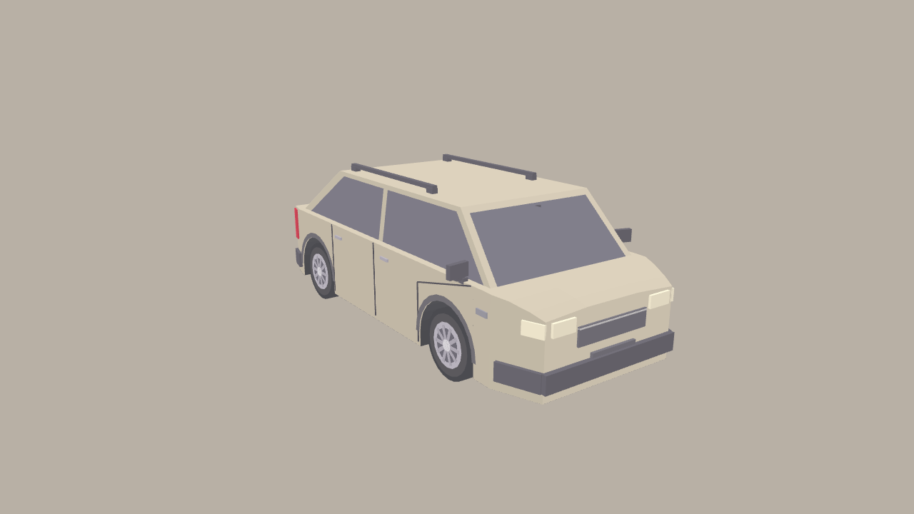
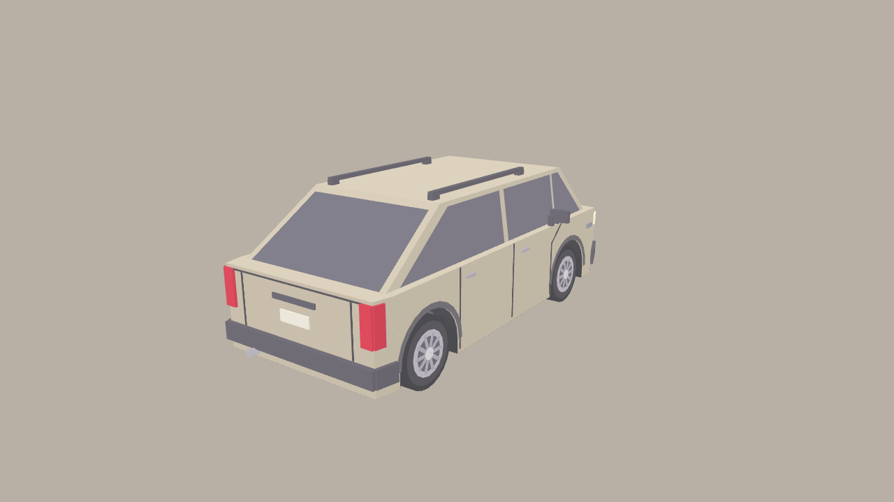
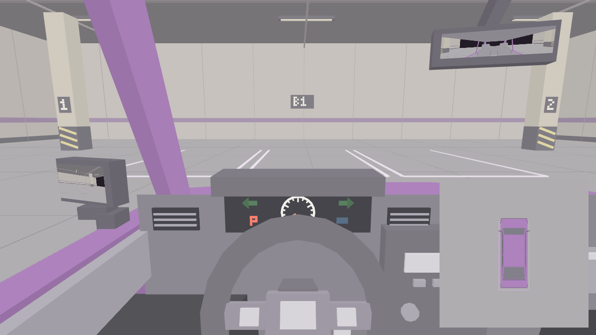
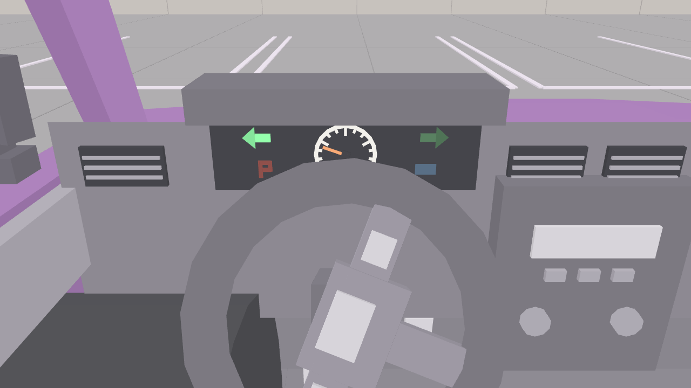
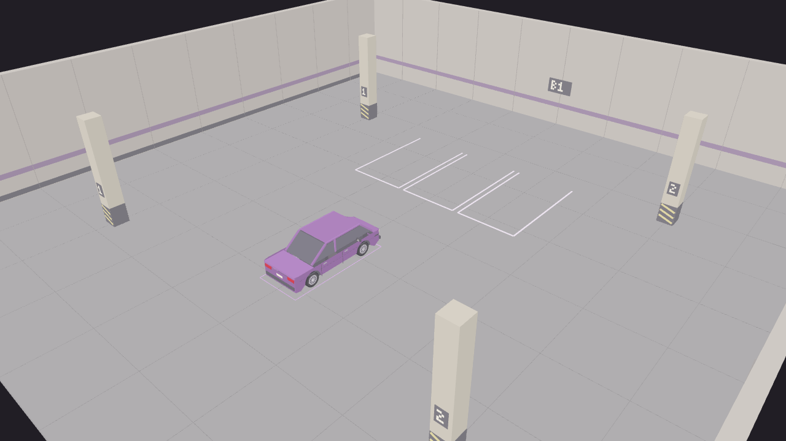
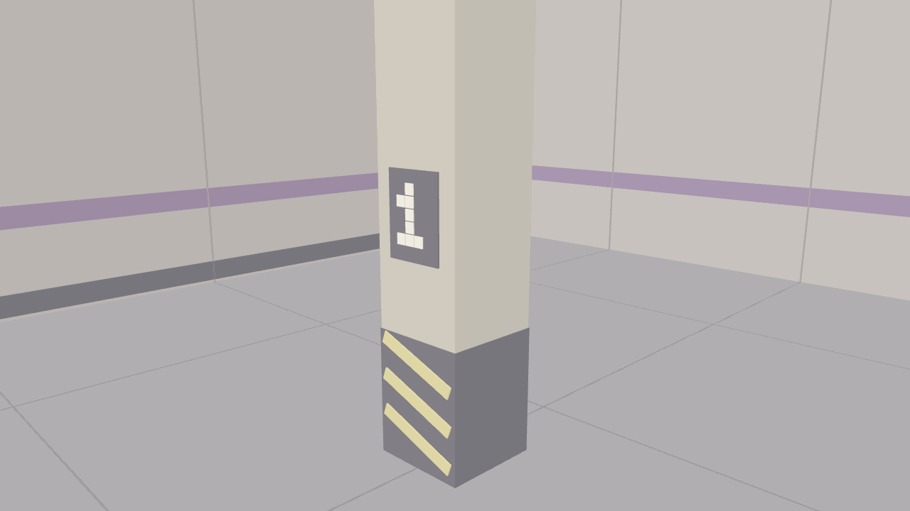
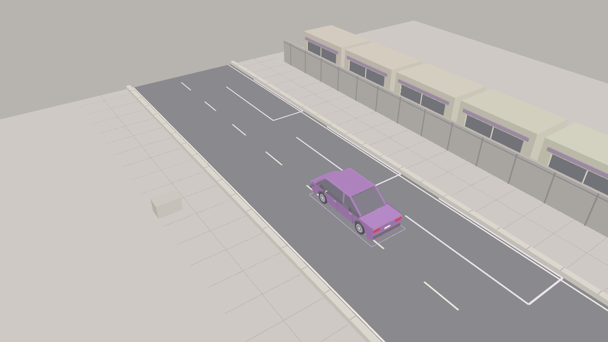
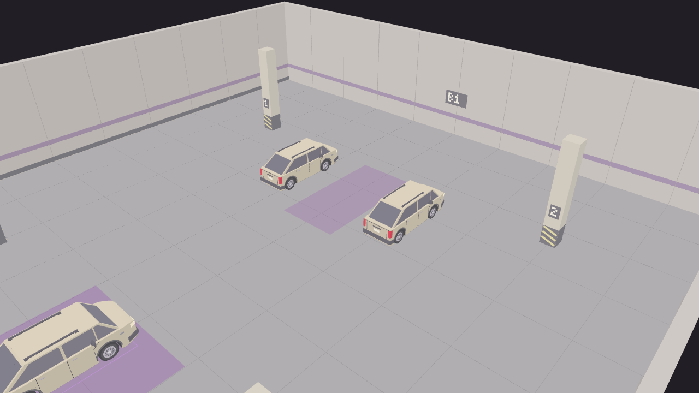

# Phase 8 Original 3D Asset Catalog

Captured and measured: 2026-11-05. These are actual GLTFLoader/WebGL renders,
not the earlier concept drawings. Artwork uses shaped low-poly geometry,
vertex colors and unlit materials; there are no image textures, downloaded
meshes, dynamic shadows or custom shaders.

## Vehicles

The amethyst sedan has a boxy three-box body. Its lower shell is closed: hood,
belt ledges, trunk deck, fascias, floor and lined wheel wells all share edges.
It has a faceted hood with a raised center panel, painted A/B/C pillars and
roof rails meeting the glass, four doors with a front quarter window, dark
wrap-around bumpers, a grille between rectangular headlamps, red/amber tail
lamps, an amber rear side marker and an exhaust tip. The ivory/charcoal CUV is a
two-box wagon on the same closed shell construction: a chamfered nose with corner
headlamps wrapping the chamfer, a dark grille, chunky wrap-around bumpers, dark
fender flares, framed windshield and raked hatch glass, thick D-pillars, roof rails
on feet and tall red corner tail lamps. Both include handles, door seams, grilles, bumpers, static lamp colors,
mirror housings and independently animated alloy wheels. Designs are generic and
unbranded.

| Asset | Width x height x length (m) | Stored triangles | Nodes / meshes | GLB bytes |
|---|---|---:|---:|---:|
| [Sedan](../public/assets/vehicles/sedan.glb) | 1.8 x 1.45 x 4.6 | 4,976 | 38 / 27 | 367,744 |
| [CUV](../public/assets/vehicles/cuv.glb) | 1.8 x 1.62 x 4.35 | 3,602 | 30 / 21 | 256,540 |

Counts include the cockpit, mirror surfaces and both stored glazing variants,
even when one is hidden. Both are below the 10,000-triangle vehicle gate.

### Sedan: front and rear

Sedan exterior redesigned for issue #12 (captured 2026-11-25). The windshield foot
moved back to z = -1.68 m and the rear-window foot forward to 1.75 m. The hood is
now 0.62 m (was 0.43 m) and the trunk deck 0.55 m (was 0.93 m). The roof rear
moved to z = 0.85 m and the side glass leans in from 0.81 to 0.72 m half-width.
These values are inferred from two reference views, not measured. The unchanged
dashboard limits how far back the windshield can go, so the hood ratio is still
shorter than the reference. The physical profile dimensions and wheel positions
are unchanged, and so is the visual/physical Z-extent mismatch. The exterior
subtask kept the eye and mirror anchors; the interior subtask below moved them.
Each side mirror housing has a low arm to the door belt, below the driver's
sightline.


### CUV: front and rear

CUV exterior redesigned for issue #12 (captured 2026-11-26). It shares the sedan's
closed shell builder (`authorClosedShell`). The windshield foot moved back to
z = -1.62 m (was -1.75 m); the reference places it further back, but the
unchanged CUV dashboard and headliner limit it, so the hood is still shorter
than the reference. The roof (z -1.10 to 1.15 m), hatch-glass foot (1.975 m) and
belt (0.99 m) are unchanged; side glass leans in from 0.82 to 0.74 m half-width.
A fixed front quarter window ends at z = -0.88 m so the unchanged side-mirror
anchor sits at the front door corner, and each mirror housing gains an arm and
foot to the door belt. These values are inferred from two reference views, not
measured. Physical profile, colliders, wheels, driver eye, mirror anchors, cameras
and faces, and cockpit geometry are unchanged, as is the visual/physical Z-extent
mismatch. The left mirror capture is still largely blocked by a dark surface, exactly
as before this change; that belongs to CUV mirror/view work.





### Cockpits and mirrors

The sedan cabin was redesigned for issue #12 (captured 2026-11-25). It has:

- A dashboard with vents, center stack (radio, buttons, knobs) and glovebox.
- An instrument binnacle with speedometer, left/right arrows, P lamp and
  headlamp icon.
- A three-spoke wheel on a 25-degree raked column, brake and accelerator
  pedals and a footrest.
- Bucket seats with bolsters and headrests, a rear bench with headrests, and a
  center console with shifter, cupholders and a storage bin.
- Door trims with armrests, handles and pockets, plus a firewall, kick panels,
  floor, headliner, sun visors and a parcel shelf.

The wheel, needle, arrows, P lamp and pedals are live: `src/render/asset-scene.ts`
drives them from telemetry each rendered frame. Positive steering (left) turns
the wheel counter-clockwise. The needle covers 0-120 km/h over 240 degrees, the
arrows flash at 1.5 Hz, and the pedals travel 0.3 rad. The CUV keeps its simpler
static cockpit (dashboard, instrument rings, wheel, seats, rear-seat
silhouette, console, floor and roof lining). Captures look slightly downward to
show controls; application camera controls are unchanged.







Driven-car window faces are opaque and outward-facing: exterior views show
closed windows while interior rays see the culled backfaces. These faces are
excluded from mirror renders. Stationary cars use separate double-sided
glazing. This is not a transparent-glass simulation.

Vehicle roots remain center-of-mass based, in meters, +Y up and -Z forward.
The sedan interior subtask moved the sedan eye back 0.3 m. It also moved the
side mirror anchors, cameras and collider boxes forward to the A-pillar base,
and put the rearview camera and display together under the windshield header.
The previous sedan values were eye (-0.36, 0.60, -0.965), rearview camera
(0, 0.72, -1.715) and side mirrors (+/-0.96, 0.43, -0.865). The physical
dimensions and chassis collider are unchanged; CUV anchors are unchanged:

| Vehicle | COM height (m) | `DriverEye` local (m) | `MirrorRear` local (m) | Left/right mirror local (m) |
|---|---:|---|---|---|
| Sedan | 0.52 | (-0.36, 0.60, -0.665) | (0, 0.74, -1.225) | (+/-0.96, 0.43, -1.45) |
| CUV | 0.62 | (-0.36, 0.68, -0.8462) | (0, 0.80, -1.5962) | (+/-0.965, 0.48, -0.7462) |

Mirror anchor yaw remains rear 180 degrees, left +105 degrees and right
-105 degrees.

- **CUV:** the smaller rearview **display mesh** sits inside the cabin, offset
  from its virtual camera by (-0.25, -0.075, +0.52) m. Side housings sit behind
  their reflective planes relative to the driver.
- **Sedan:** the rearview display (0.18 x 0.045 m, the 4:1 aspect of its
  RenderTarget) coincides with its camera and hangs from the headliner on a
  stem. Each sedan mirror face bisects the directions to the eye and to its
  camera's view, like a real mirror. Its housing sits behind it, so no camera
  sees its own housing.

The displays are view proxies, not calibrated optical mirrors. Planar mirror
surfaces have UVs, and updates keep the existing 15 FPS cap.
Loaded-mesh 9 x 9 ray grids verify both side faces are unobstructed from
each fixed eye; this does not establish optical calibration.

## Environments and modular objects

| Asset | Declared width x height x depth (m) | Stored triangles | Nodes / meshes | GLB bytes |
|---|---|---:|---:|---:|
| [Underground garage](../public/assets/environments/garage.glb) | 30 x 6 x 30 | 2,160 | 19 / 14 | 182,624 |
| [Urban roadside](../public/assets/environments/roadside.glb) | 50 x 3 x 32 | 1,968 | 12 / 9 | 162,796 |

Both are below the 30,000-triangle environment gate. Repeated static details
are merged into compatible batches rather than separate objects/draw calls.

### Underground garage

Concrete floor/wall joints, amethyst wall bands, bay markings, B1 and pillar
identifiers, protective pillar bases, hazard stripes, overhead pipes/supports
and bright static fixture faces make the space recognizable. Fixture faces
are geometry, not lights or an image-based lighting bake.





The cockpit pictures above also show ceiling fixtures and pipe runs.
All overhead details remain in `Ceiling`, excluded from the overhead camera
but retained in ordinary views.


### Urban roadside

The road has an asphalt color region, lane/edge markings, sidewalk slabs,
curb joints, a concrete barrier block and detailed existing fence. Restrained
background frontages sit behind that physical fence, outside the reachable
driving surface; they do not introduce traversable solid-looking buildings.




### Parked lesson cars and guidance

Every existing lesson obstacle now has a visible stationary car, reusing the
selected vehicle's exterior and wheels without its cockpit or live mirror
surfaces. Each owns cloned geometry/materials and is fitted to the exact
collider box before applying its yaw. Stationary geometry is 2,790 triangles
for sedan and 2,992 for CUV, below the 4,000-triangle gate.



Stages 1, 2, 3 and 5 each have two parked cars; Stage 4 has one. Narrow
obstacles intentionally produce narrower visual cars to match the unchanged
training layout. Collision remains a **simple box approximation**, not
per-polygon contact with curved artwork. No physics vehicles are added.

Generic environment bay lines are hidden during lessons so they cannot
contradict lesson targets. Sandbox bay lines, target/highlight planes,
trajectory guidance and sensor overlays retain their existing behavior.

## Payload and actual rendering measurements

Only the selected vehicle/environment pair is loaded; parked cars reuse it.
All GLBs are self-contained and use no external image/buffer resources.

| Selected pair | Uncompressed bytes |
|---|---:|
| Sedan + garage | 383,172 |
| Sedan + roadside | 363,344 |
| CUV + garage | 439,164 |
| CUV + roadside | 419,336 |

All pairs are below the 5,000,000-byte gate.

The test fixture measures the real view pipeline at a settled spawn with
driver view, trajectory and overhead enabled, 1280 x 720. Counters are reset
and read **around each actual render**, not once across unrelated passes.
The table reports an auxiliary-update frame at 80 ms:

| Scene | Main calls / triangles | Three mirror calls | Overhead calls | Composite calls | Full-frame calls |
|---|---:|---|---:|---:|---:|
| Sedan + garage | 26 / 3,218 | 27 + 16 + 16 | 31 | 1 | 117 |
| Sedan + roadside | 22 / 3,038 | 25 + 16 + 16 | 31 | 1 | 111 |
| CUV + garage | 26 / 3,334 | 27 + 16 + 16 | 31 | 1 | 117 |
| CUV + roadside | 22 / 3,154 | 25 + 16 + 16 | 31 | 1 | 111 |
| Stage 1, CUV | 57 / 7,970 | 27 + 18 + 18 | 31 | 1 | 152 |
| Stage 2, CUV | 22 / 3,170 | 62 + 18 + 18 | 31 | 1 | 152 |
| Stage 3, CUV | 32 / 4,226 | 45 + 17 + 26 | 48 | 1 | 169 |
| Stage 4, CUV | 23 / 3,182 | 47 + 18 + 21 | 32 | 1 | 142 |
| Stage 5, CUV | 26 / 3,274 | 43 + 17 + 26 | 47 | 1 | 160 |

The gates are <=100 **main-pass** calls in sandbox and <=140 in lessons,
not limits on the sum of all camera passes. These sampled poses pass; their
full-frame costs are explicitly larger. A frame at 20 ms has no mirror
update, preserving the existing rate cap. Counts are not an FPS benchmark
or a worst-case guarantee for every driving pose.

## Reproduce and inspect

```powershell
node tools\generate-assets.mjs
npx vitest run src\world\generate-assets.test.mjs src\world\assets.test.mjs
npx playwright test phase-8-assets.spec.ts
```

Editable artwork is in `tools\asset-designs`; generic geometry helpers and the
GLB writer are separate. Browser captures are written to test artifacts, never
automatically over the committed pictures. Inspect artifacts before choosing
updated catalog images. The fixture and its capture API are test-only, not
part of the production app. See [asset pipeline](asset-pipeline.md).

## Verification limits

Final software checks passed: 487 unit/DOM/physics/asset tests, 37 explicitly
selected generator/loader checks, typecheck, production build, 40 Chromium
browser checks (including both five-stage journeys) and five production
checks. The explicit asset selection overlaps the ordinary suite; these
numbers are not additive. No lint script exists. The existing bundle-size
warning remains.

The branch includes the current Phase 7 learner experience. Its app captures
follow the real tutorial/menu/settings/briefing flow rather than bypassing it.
The independent whole-branch review found side-mirror housing obstruction;
driver-eye grid regressions reproduced it before the housing correction,
and all software gates above passed after that fix.

Captures used Chromium 156.0.8078.4 with ANGLE Vulkan **SwiftShader**, not the
host's hardware GPU. App screenshots are 1920 x 1080; asset captures are
1280 x 720. The 2560 x 1440 benchmark was attempted with honest metadata,
but the host display was 144 Hz, so the existing 60 Hz eligibility gate
rejected it before measurement. No cases or FPS were measured.

The approved 1440p60 target (p95 <=17.5 ms, mean >=57 FPS, zero loss) is
**unverified**. These runs used Node 24.13.1, below the declared 24.15.0
floor for that major. Supported-Node, reference/minimum-PC, physical wheel,
manual labeled mirror-landmark, vehicle-clearance, route and instructor
validation remain pending. Artwork and software checks do not establish
real-world training readiness.

## Provenance and license

Original geometry, palette choices and compositions were authored for
Park-Core by Park-Core contributors. No third-party artwork was imported;
no manufacturer identity is claimed. Regeneration is deterministic, and
license/attribution metadata is embedded in each GLB.

New creative definitions, GLBs and artwork-focused pictures are
[CC BY-NC 4.0](../public/assets/LICENSE): freely share/adapt for
**noncommercial** purposes with attribution, a license link and an indication
of changes. Attribute "Park-Core contributors, Park-Core Phase 8 original
artwork" and link the [source repository](https://github.com/nguyenviettung7691/park-core).
See the [creative-source notice](../tools/asset-designs/LICENSE) and
[picture notice](images/phase-8/LICENSE).

Application code, generic generation mechanics and technical documentation
remain [MIT](../LICENSE). The new artwork is source-available, **not
OSI-open-source** because commercial use is restricted. Existing MIT grants
on earlier versions remain valid; dependency/tool licenses are unchanged.
