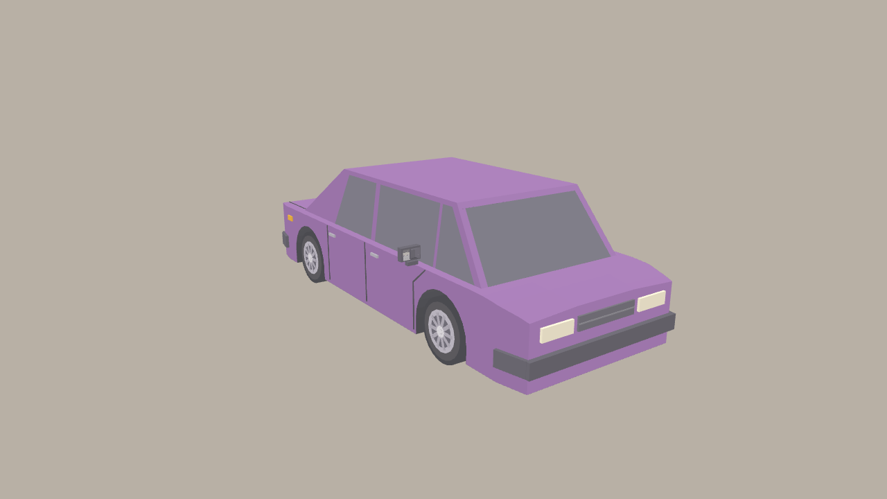
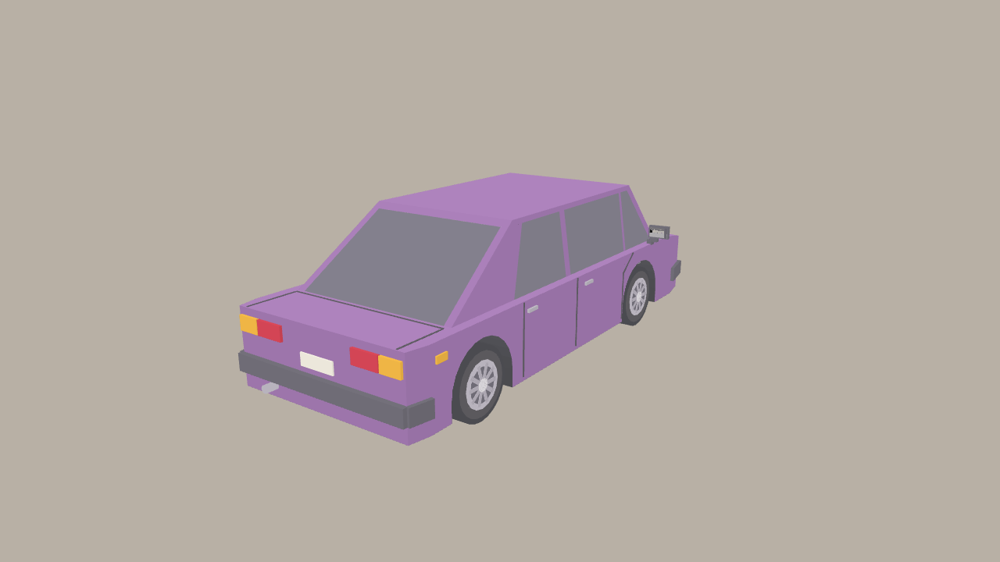
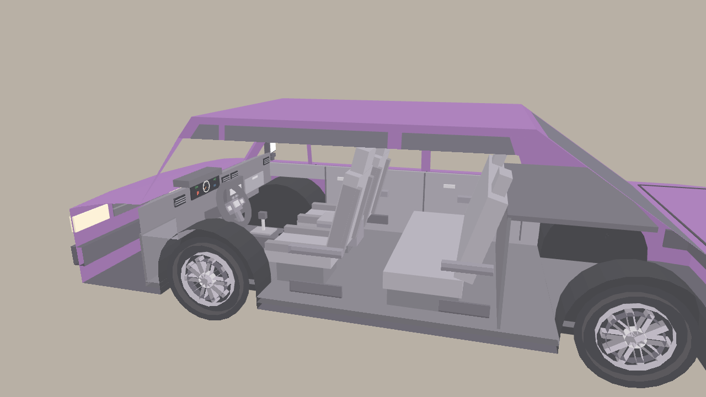
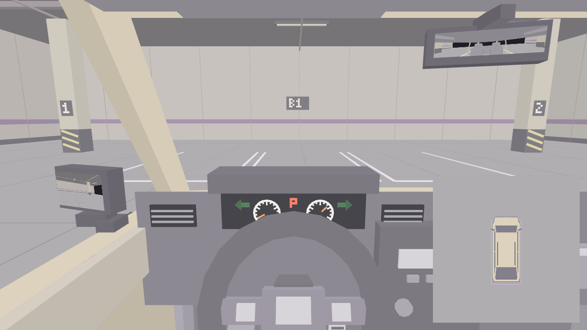
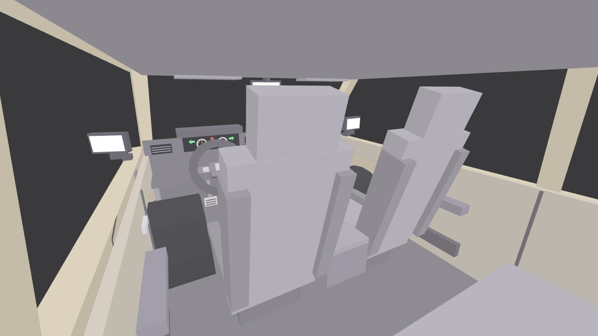
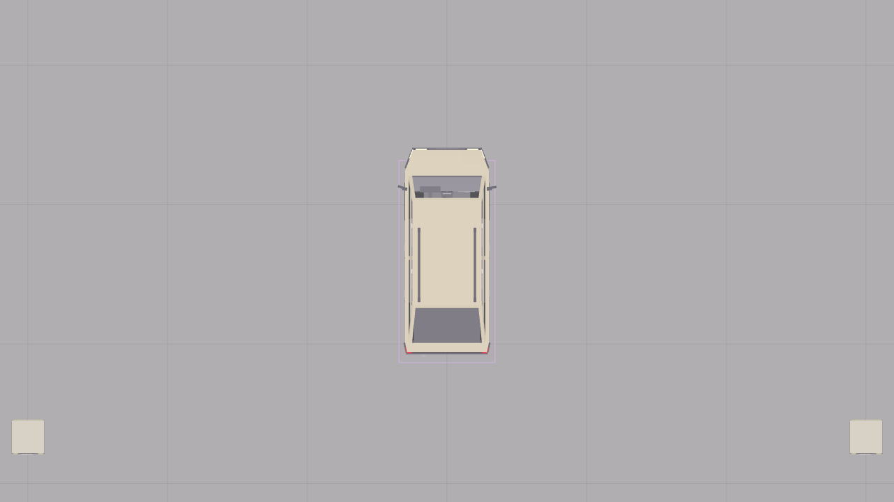
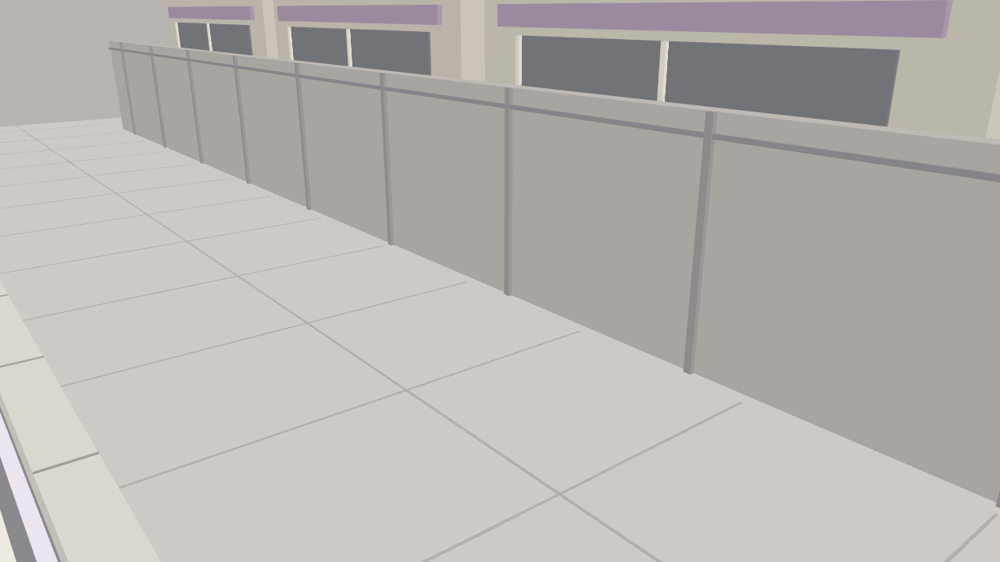

# Phase 8 Original 3D Asset Catalog

Captured and measured: 2026-11-05; vehicle pictures, payload and render-call
measurements refreshed for issue #12 on 2026-11-26. These are actual GLTFLoader/WebGL renders,
not the earlier concept drawings. Artwork uses shaped low-poly geometry,
vertex colors and unlit materials; there are no image textures, downloaded
meshes, dynamic shadows or custom shaders.

## Vehicles

The amethyst sedan has a boxy three-box body. Its lower shell is closed: hood,
belt ledges, trunk deck, fascias, floor and lined wheel wells all share edges.
It has a faceted hood with a raised center panel, painted A/B/C pillars and
roof rails meeting the glass, four doors with a front quarter window, dark
wrap-around bumpers, a grille between rectangular headlamps, red/amber tail
lamps, an amber rear side marker and an exhaust tip. The ivory/charcoal CUV is a
two-box wagon on the same closed shell construction: a chamfered nose with corner
headlamps wrapping the chamfer, a dark grille, chunky wrap-around bumpers, dark
fender flares, framed windshield and raked hatch glass, thick D-pillars, roof rails
on feet and tall red corner tail lamps. Both include handles, door seams, grilles, bumpers, static lamp colors,
mirror housings and independently animated alloy wheels. Designs are generic and
unbranded.

| Asset | Width x height x length (m) | Stored triangles | Nodes / meshes | GLB bytes |
|---|---|---:|---:|---:|
| [Sedan](../public/assets/vehicles/sedan.glb) | 1.8 x 1.45 x 4.6 | 4,976 | 38 / 27 | 367,744 |
| [CUV](../public/assets/vehicles/cuv.glb) | 1.8 x 1.62 x 4.35 | 5,650 | 39 / 28 | 413,648 |

Counts include the cockpit, mirror surfaces and both stored glazing variants,
even when one is hidden. Both are below the 10,000-triangle vehicle gate.
The figures above describe the **current public GLBs**, which do not yet have
exterior lamps (see the next section).

### Exterior lamps (issue #11): candidates pending developer approval

Candidate vehicle GLBs add four hidden lit-lamp nodes under `Body` (so under
`Exterior`): `BrakeLampsLit`, `ReverseLampsLit`, `TurnSignalLeftLit` and
`TurnSignalRightLit`. Each is one batched mesh of thin (6 mm) bright vertex-color
panels placed 4 mm outboard of the static lamps. `exteriorLampState` and
`createAssetScene.apply` in `src/render/asset-scene.ts` show them from telemetry:
brake above 0.05, reverse in R, and the indicators from the same 1.5 Hz flash as
the cockpit arrows. Parked lesson cars hide them. Placements of the sedan high
mount and the reverse/side-repeater lamps are inferred, not measured.

**These GLBs are not promoted.** The lamps are authored only with the
generator's `--lamps` option (default off), so the checked-in
`public/assets/vehicles/*.glb` files and default generation stay in sync while
the lamp captures await developer approval. Promotion flips the default after
approval (see `docs/asset-pipeline.md`). Candidate figures (pending, not yet
catalog values; candidate sha256 sedan `84eaccc0…`, CUV `d4626703…`):

| Candidate | Stored triangles | GLB bytes |
|---|---:|---:|
| Sedan | 5,108 | 382,072 |
| CUV | 5,758 | 426,084 |

Both stay below the 10,000-triangle and 5,000,000-byte gates. Candidate SHA-256:
sedan `84eaccc02a7b54f7781b22724dcf0c5d9854660aad328a8cd9b7a153615d2745`, CUV
`d4626703e79e238bbb3edf43340918725dc5b19f9f33e3ea6f37548e7129b64b`.

### Sedan: front and rear

Sedan exterior redesigned for issue #12 (captured 2026-11-25). The windshield foot
moved back to z = -1.68 m and the rear-window foot forward to 1.75 m. The hood is
now 0.62 m (was 0.43 m) and the trunk deck 0.55 m (was 0.93 m). The roof rear
moved to z = 0.85 m and the side glass leans in from 0.81 to 0.72 m half-width.
These values are inferred from two reference views, not measured. The unchanged
dashboard limits how far back the windshield can go, so the hood ratio is still
shorter than the reference. The physical profile dimensions and wheel positions
are unchanged, and so is the visual/physical Z-extent mismatch. The exterior
subtask kept the eye and mirror anchors; the interior subtask below moved them.
Each side mirror housing has a low arm to the door belt, below the driver's
sightline.





### CUV: front and rear

CUV exterior redesigned for issue #12 (captured 2026-11-26). It shares the sedan's
closed shell builder (`authorClosedShell`). The windshield foot moved back to
z = -1.62 m (was -1.75 m); the reference places it further back, but the
unchanged CUV dashboard and headliner limit it, so the hood is still shorter
than the reference. The roof (z -1.10 to 1.15 m), hatch-glass foot (1.975 m) and
belt (0.99 m) are unchanged; side glass leans in from 0.82 to 0.74 m half-width.
A fixed front quarter window ends at z = -0.88 m so the unchanged side-mirror
anchor sits at the front door corner, and each mirror housing gains an arm and
foot to the door belt. These values are inferred from two reference views, not
measured. Physical profile, colliders and wheels are unchanged, as is the
visual/physical Z-extent mismatch. The later CUV interior subtask moved the side
mirrors to the A-pillar base, so the front quarter window (divider at z = -0.88 m)
was removed and the front door glass runs from the A-pillar to the B-pillar.


### Cockpits and mirrors

The sedan cabin was redesigned for issue #12 (captured 2026-11-25). It has:

- A dashboard with vents, center stack (radio, buttons, knobs) and glovebox.
- An instrument binnacle with speedometer, left/right arrows, P lamp and
  headlamp icon.
- A three-spoke wheel on a 25-degree raked column, brake and accelerator
  pedals and a footrest.
- Bucket seats with bolsters and headrests, a rear bench with headrests, and a
  center console with shifter, cupholders and a storage bin.
- Door trims with armrests, handles and pockets, plus a firewall, kick panels,
  floor, headliner, sun visors and a parcel shelf.

The wheel, needle, arrows, P lamp and pedals are live: `src/render/asset-scene.ts`
drives them from telemetry each rendered frame. Positive steering (left) turns
the wheel counter-clockwise. The needle covers 0-120 km/h over 240 degrees, the
arrows flash at 1.5 Hz, and the pedals travel 0.3 rad. Captures look slightly
downward to show controls; application camera controls are unchanged.

The CUV cabin was redesigned for issue #12 (captured 2026-11-26). It reuses the
sedan cabin with its Cockpit node shifted by the eye difference (+0.18 m up,
+0.119 m back), because the CUV windshield foot, header and wheel wells sit at
nearly the same eye-relative places. CUV-specific parts follow its references:
a speedometer and a static second gauge with the P lamp between them and the
turn arrows outboard (the binnacle hood hides arrows placed above the dials);
ribbed brake/accelerator pads; a shifter boot; beige door trims; a cargo cover
over the open cargo bay instead of the sedan's parcel shelf and bulkhead; and a
console hand lever, `ParkingBrakeLever`, that lifts 0.35 rad while the parking
brake is applied. It has the same live controls as the sedan.









Driven-car window faces are opaque and outward-facing: exterior views show
closed windows while interior rays see the culled backfaces. These faces are
excluded from mirror renders. Stationary cars use separate double-sided
glazing. This is not a transparent-glass simulation.

Vehicle roots remain center-of-mass based, in meters, +Y up and -Z forward.
The sedan and CUV interior subtasks each moved the eye back 0.3 m. They also
moved the side mirror anchors, cameras and collider boxes forward 0.585 m to the
A-pillar base, and put the rearview camera and display together under the
windshield header. The previous sedan values were eye (-0.36, 0.60, -0.965),
rearview camera (0, 0.72, -1.715) and side mirrors (+/-0.96, 0.43, -0.865). The
previous CUV values were eye (-0.36, 0.68, -0.8462), rearview camera
(0, 0.80, -1.5962) and side mirrors (+/-0.965, 0.48, -0.7462). The physical
dimensions and chassis colliders are unchanged:

| Vehicle | COM height (m) | `DriverEye` local (m) | `MirrorRear` local (m) | Left/right mirror local (m) |
|---|---:|---|---|---|
| Sedan | 0.52 | (-0.36, 0.60, -0.665) | (0, 0.74, -1.225) | (+/-0.96, 0.43, -1.45) |
| CUV | 0.62 | (-0.36, 0.68, -0.5462) | (0, 0.82, -1.1062) | (+/-0.965, 0.48, -1.3312) |

Mirror anchor yaw remains rear 180 degrees, left +105 degrees and right
-105 degrees.

Both vehicles: the rearview display (0.18 x 0.045 m, the 4:1 aspect of its
RenderTarget) coincides with its camera and hangs from the headliner on a stem.
Each mirror face bisects the directions to the eye and to its camera's view,
like a real mirror. Its housing sits behind it, so no camera sees its own
housing; this also cleared the CUV left mirror, which previously showed mostly
its own housing.

The displays are view proxies, not calibrated optical mirrors. Planar mirror
surfaces have UVs, and updates keep the existing 15 FPS cap.
Loaded-mesh 9 x 9 ray grids verify both side faces are unobstructed from
each fixed eye; this does not establish optical calibration.

## Environments and modular objects

| Asset | Declared width x height x depth (m) | Stored triangles | Nodes / meshes | GLB bytes |
|---|---|---:|---:|---:|
| [Underground garage](../public/assets/environments/garage.glb) | 30 x 6 x 30 | 2,228 | 21 / 15 | 188,796 |
| [Urban roadside](../public/assets/environments/roadside.glb) | 50 x 3 x 32 | 1,968 | 12 / 9 | 162,800 |

Both are below the 30,000-triangle environment gate. Repeated static details
are merged into compatible batches rather than separate objects/draw calls.

### Underground garage

Concrete floor/wall joints, amethyst wall bands, bay markings, B1 and pillar
identifiers, protective pillar bases, hazard stripes, overhead pipes/supports
and bright static fixture faces make the space recognizable. Fixture faces
are geometry, not lights or an image-based lighting bake.


#### Wheel stops (issue #11)

`WallsAndCurbs/WheelStopTemplate` is a hidden template: one batched mesh, 68
triangles, a 1.8 x 0.11 x 0.15 m concrete prism with 0.025 m top chamfers and two
yellow bands. The lesson scene clones it per `wheel-stop` collider (half extents
0.9 x 0.055 x 0.075 m) in stages 1, 2 and 4: `stage1-wheel-stop` at z = -6.70,
`stage2-wheel-stop` at z = -8.60 and `stage4-wheel-stop` at (x 5.4, z = -8.60). The
garage GLB grew by that template (+68 triangles, +6,172 bytes). The car's tyres
meet the stop's top edge when the tyre centre is about 0.24 m from its near face;
measured resting poses leave 0.29 to 0.83 m of margin inside the target (minimum
0.288 m, stage 4 sedan). A 15 km/h approach fails with `wheel-stop-mounted`.
Climbing is momentum-only, so the measured mount threshold is far below that
(coasting from 1 m with no brake, leading axle into the stop, both vehicles):
reversing in stages 2 and 4 a 1.2 m/s (4.3 km/h) arrival rests touching and
1.5 m/s (5.4 km/h, walking pace) mounts the stop and fails; nose-in in stage 1,
1.5 m/s climbs part way and rolls back and 2.0 m/s (7.2 km/h) fails. Braking hard
at first touch from 2.5 m/s still mounts it in stages 2 and 4. Creep
(0.56 m/s reverse, 0.83 m/s forward) never does. `edge-physics.test.ts` pins these
speeds (`coasting into the stop`).
The stop is a simple box collider, not per-polygon contact. The environment
GLBs (0.11 m curbs, this template) are promoted on the branch because the art has
to match the colliders, but their **visual approval is pending the developer**:
merging the issue #11 PR is gated on that approval, and the garage capture images
under `images/phase-8` were not refreshed.

The cockpit pictures above also show ceiling fixtures and pipe runs.
All overhead details remain in `Ceiling`, excluded from the overhead camera
but retained in ordinary views.



### Urban roadside

The road has an asphalt color region, lane/edge markings, sidewalk slabs,
curb joints (curbs 0.11 m tall since issue #11; 0.3 m wide, unchanged), a concrete barrier block and
detailed existing fence. Restrained
background frontages sit behind that physical fence, outside the reachable
driving surface; they do not introduce traversable solid-looking buildings.




Issue #11 lowered the curb to 0.11 m (collider centre y 0.055, half extents
0.15 x 0.055 x 16 m at x = +/-4.2; art and joint lines moved with it). It was
first lowered to 0.12 m, but a hard brake in reverse beside that curb left the
sedan's chassis corner only 0.8 mm above the curb top, so it now matches the
0.11 m wheel stops. Tyres rest on the curb's top edge through tyre-edge contact
(`src/vehicle/tyre-edges.ts`, `rig.ts`) instead of hitting a vertical wall: a
touch is a warning in lessons and climbing or mounting fails. Roadside driving
bounds are the curb's outer face (half width 4.35 m).

Lowest chassis-box corner above the curb top during a hard brake (brake 1) from
2 m/s beside the curb, tyre 0.02 m from its face (`edge-physics.test.ts`), for
corners within 0.5 m of the curb face in plan (the asserted figure), with the
lowest of all four corners in brackets:

| Vehicle | D | D, steer +0.4 | D, steer -0.4 | R | R, steer +0.4 | R, steer -0.4 |
|---|---:|---:|---:|---:|---:|---:|
| Sedan | 13.763 (13.763) mm | 14.293 (10.590) mm | 34.451 (13.944) mm | 10.754 (10.754) mm | 22.208 (-5.290) mm | 14.522 (6.545) mm |
| CUV | 38.046 (38.046) mm | 38.233 (34.761) mm | 63.177 (31.707) mm | 34.470 (34.470) mm | 47.784 (17.798) mm | 38.889 (29.676) mm |

The test requires at least 2 mm near the curb (sedan minimum 10.754 mm, R). Since
the review-r1 edge fix (a steered tyre grazing the curb is held at the face
instead of rubbing 3 cm into it), the sedan in R with steer +0.4 rolls toward the
far side: its lowest corner (far rear, about 1.8 m from the curb) dips 5.3 mm
below curb height there, over open road, so the all-corner figure is no longer a
clearance. The simulation is deterministic, so the 2 mm bound is not a noise
allowance: it is a margin, so a tuning change that eats clearance fails the test
before it shows as a chassis hit (which the test also checks). The roadside GLB's
triangle count is unchanged; it is 4 bytes larger (162,800).

### Parked lesson cars and guidance

Every existing lesson obstacle now has a visible stationary car, reusing the
selected vehicle's exterior and wheels without its cockpit or live mirror
surfaces. Each owns cloned geometry/materials and is fitted to the exact
collider box before applying its yaw. Stationary geometry is 2,790 triangles
for sedan and 2,996 for CUV, below the 4,000-triangle gate.


Stages 1, 2, 3 and 5 each have two parked cars; Stage 4 has one. Narrow
obstacles intentionally produce narrower visual cars to match the unchanged
training layout. Collision remains a **simple box approximation**, not
per-polygon contact with curved artwork. No physics vehicles are added.

Generic environment bay lines are hidden during lessons so they cannot
contradict lesson targets. Sandbox bay lines, target/highlight planes,
trajectory guidance and sensor overlays retain their existing behavior.

## Payload and actual rendering measurements

Only the selected vehicle/environment pair is loaded; parked cars reuse it.
All GLBs are self-contained and use no external image/buffer resources.

| Selected pair | Uncompressed bytes |
|---|---:|
| Sedan + garage | 556,540 |
| Sedan + roadside | 530,544 |
| CUV + garage | 602,444 |
| CUV + roadside | 576,448 |

All pairs are below the 5,000,000-byte gate.

The test fixture measures the real view pipeline at a settled spawn with
driver view, trajectory and overhead enabled, 1280 x 720. Counters are reset
and read **around each actual render**, not once across unrelated passes.
The table reports an auxiliary-update frame at 80 ms:

| Scene | Main calls / triangles | Three mirror calls | Overhead calls | Composite calls | Full-frame calls |
|---|---:|---|---:|---:|---:|
| Sedan + garage | 34 / 6,166 | 24 + 15 + 15 | 35 | 1 | 124 |
| Sedan + roadside | 30 / 5,986 | 22 + 15 + 15 | 35 | 1 | 118 |
| CUV + garage | 32 / 5,952 | 24 + 15 + 15 | 36 | 1 | 123 |
| CUV + roadside | 28 / 5,772 | 22 + 15 + 15 | 36 | 1 | 117 |
| Stage 1, CUV | 63 / 11,844 | 24 + 17 + 17 | 36 | 1 | 158 |
| Stage 2, CUV | 28 / 5,788 | 59 + 17 + 17 | 36 | 1 | 158 |
| Stage 3, CUV | 39 / 7,498 | 40 + 16 + 25 | 53 | 1 | 174 |
| Stage 4, CUV | 29 / 5,800 | 44 + 17 + 20 | 37 | 1 | 148 |
| Stage 5, CUV | 33 / 6,538 | 40 + 15 + 25 | 52 | 1 | 166 |

Measured 2026-11-26 after the issue #12 redesign. The sedan's lesson stages peak
at 65 main-pass calls (Stage 1). With the issue #11 garage wheel stops, CUV Stage 1
is 64 / 11,912 main calls / triangles (full frame 159 calls) and stages 2 and 4
are unchanged in the main pass (28 / 5,788 and 29 / 5,800) because the stop is
culled from the spawn camera; their full-frame count is one higher (159 and 149).
Every touching-pose frame stayed at or below the 140 main-pass gate. The vehicle
candidates with lamps (pending, above) add under 140 triangles each and no draw
calls while the lamps are hidden.

The gates are <=100 **main-pass** calls in sandbox and <=140 in lessons,
not limits on the sum of all camera passes. These sampled poses pass; their
full-frame costs are explicitly larger. A frame at 20 ms has no mirror
update, preserving the existing rate cap. Counts are not an FPS benchmark
or a worst-case guarantee for every driving pose.

## Cockpit visibility (issue #11)

Neutral driver-view captures at the stage 1 touching pose (1280 x 720, idle
telemetry) were checked for both vehicles after the physics, lamp and stop changes,
and no cockpit anchor was moved. The steering wheel rim, the left and right
indicator arrows and the P lamp are visible. The CUV shows both dial needles.
In the sedan the speedometer needle is visible only as a short tip above the wheel
rim at 0 km/h, so it is mostly hidden by the rim in the neutral pose (not checked at
speed). The cockpit anchors are unchanged by issue #11.

## Reproduce and inspect

```powershell
node tools\generate-assets.mjs
npx vitest run src\world\generate-assets.test.mjs src\world\assets.test.mjs
npx playwright test phase-8-assets.spec.ts
```

Plain generation reproduces the approved public GLBs; unapproved issue #11 lamp
candidates need `--lamps` (with `--vehicle` and `--out`, see
`docs/asset-pipeline.md`).

Exterior lamp captures (unlit, brake, reverse, left, right and all-lit, from the
rear and front quarter) come from `asset-review.spec.ts` and load candidate bytes
through `PARK_CORE_REVIEW_VEHICLE` and `PARK_CORE_REVIEW_CANDIDATE` (the
`assets:review ... --lamps` command sets both and links them as `<vehicle>-lamps`):

```powershell
$env:PARK_CORE_REVIEW_VEHICLE='sedan'
$env:PARK_CORE_REVIEW_CANDIDATE='<candidate root containing public\assets\vehicles\sedan.glb>'
npx playwright test asset-review.spec.ts -g "exterior lamp"
```

Without a candidate the lamp test is skipped while the public GLB has no lamp nodes.
`phase-8-assets.spec.ts` also captures the wheel-stop rest poses (stages 1, 2, 4)
and a right-tyre touch on the roadside curb.

Editable artwork is in `tools\asset-designs`; generic geometry helpers and the
GLB writer are separate. Browser captures are written to test artifacts, never
automatically over the committed pictures. Inspect artifacts before choosing
updated catalog images. The fixture and its capture API are test-only, not
part of the production app. See [asset pipeline](asset-pipeline.md).

## Verification limits

Final software checks for issue #12 (2026-11-26) passed: 567 unit/DOM/physics/asset
tests, the CUV `assets:review` (72 focused generator/loader checks plus four browser
review checks), typecheck, production build, 50 Chromium browser checks (including
both five-stage journeys) and six production checks. The focused asset selection
overlaps the ordinary suite; these numbers are not additive. No lint script exists. The existing bundle-size
warning remains.

The branch includes the current Phase 7 learner experience. Its app captures
follow the real tutorial/menu/settings/briefing flow rather than bypassing it.
The independent whole-branch review found side-mirror housing obstruction;
driver-eye grid regressions reproduced it before the housing correction,
and all software gates above passed after that fix.

Captures used Chromium 156.0.8078.4 with ANGLE Vulkan **SwiftShader**, not the
host's hardware GPU. App screenshots are 1920 x 1080; asset captures are
1280 x 720. The 2560 x 1440 benchmark was attempted with honest metadata,
but the host display was 144 Hz, so the existing 60 Hz eligibility gate
rejected it before measurement. No cases or FPS were measured.

Issue #11 captures and measurements also came from SwiftShader. They do not
verify 1440p60 performance or training readiness, and the physics, lamp and stop
behaviour have not been validated against a real vehicle or reference hardware.

The approved 1440p60 target (p95 <=17.5 ms, mean >=57 FPS, zero loss) is
**unverified**. These runs used Node 24.13.1, below the declared 24.15.0
floor for that major. Supported-Node, reference/minimum-PC, physical wheel,
manual labeled mirror-landmark, vehicle-clearance, route and instructor
validation remain pending. Artwork and software checks do not establish
real-world training readiness.

## Provenance and license

Original geometry, palette choices and compositions were authored for
Park-Core by Park-Core contributors. No third-party artwork was imported;
no manufacturer identity is claimed. Regeneration is deterministic, and
license/attribution metadata is embedded in each GLB.

New creative definitions, GLBs and artwork-focused pictures are
[CC BY-NC 4.0](../public/assets/LICENSE): freely share/adapt for
**noncommercial** purposes with attribution, a license link and an indication
of changes. Attribute "Park-Core contributors, Park-Core Phase 8 original
artwork" and link the [source repository](https://github.com/nguyenviettung7691/park-core).
See the [creative-source notice](../tools/asset-designs/LICENSE) and
[picture notice](images/phase-8/LICENSE).

Application code, generic generation mechanics and technical documentation
remain [MIT](../LICENSE). The new artwork is source-available, **not
OSI-open-source** because commercial use is restricted. Existing MIT grants
on earlier versions remain valid; dependency/tool licenses are unchanged.
