# Phase 8 Original 3D Asset Catalog

Captured and measured: 2026-11-06. These are actual GLTFLoader/WebGL renders,
not the earlier concept drawings. Artwork uses shaped low-poly geometry,
vertex colors and unlit materials; there are no image textures, downloaded
meshes, dynamic shadows or custom shaders.

## Vehicles

The amethyst sedan has a low three-box body, a longer rounded hood and a
distinct shorter angular trunk. The ivory/charcoal CUV has a taller cabin, roof
rails, wheel-arch cladding, an upright hatch and vertical rear lamps. Both
include handles, door seams, grilles, bumpers, static lamp colors, mirror
housings, stems, pale exterior reflector faces, and independently animated
alloy wheels. Designs are generic and unbranded. The side shell follows the
glazing and roof boundaries down to the rear deck; the Sedan has a volumetric
0.03 m trunk lid, and the CUV rear deck spans the full body width to close
rear-side gaps.

| Asset | Width x height x length (m) | Stored triangles | Nodes / meshes | GLB bytes |
|---|---|---:|---:|---:|
| [Sedan](../public/assets/vehicles/sedan.glb) | 1.8 x 1.45 x 4.6 | 3,270 | 43 / 31 | 240,280 |
| [CUV](../public/assets/vehicles/cuv.glb) | 1.8 x 1.62 x 4.35 | 3,390 | 42 / 30 | 248,452 |

Counts include the cockpit, mirror surfaces and both stored glazing variants,
even when one is hidden. Both are below the 10,000-triangle vehicle gate.

### Sedan: front and rear

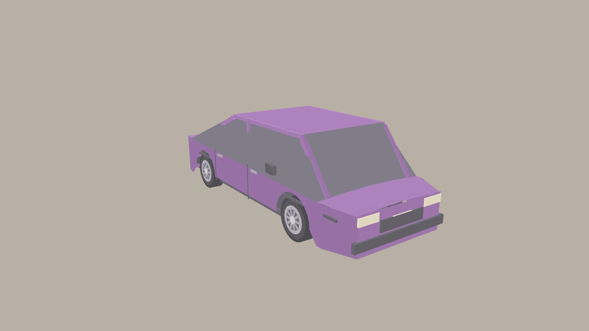

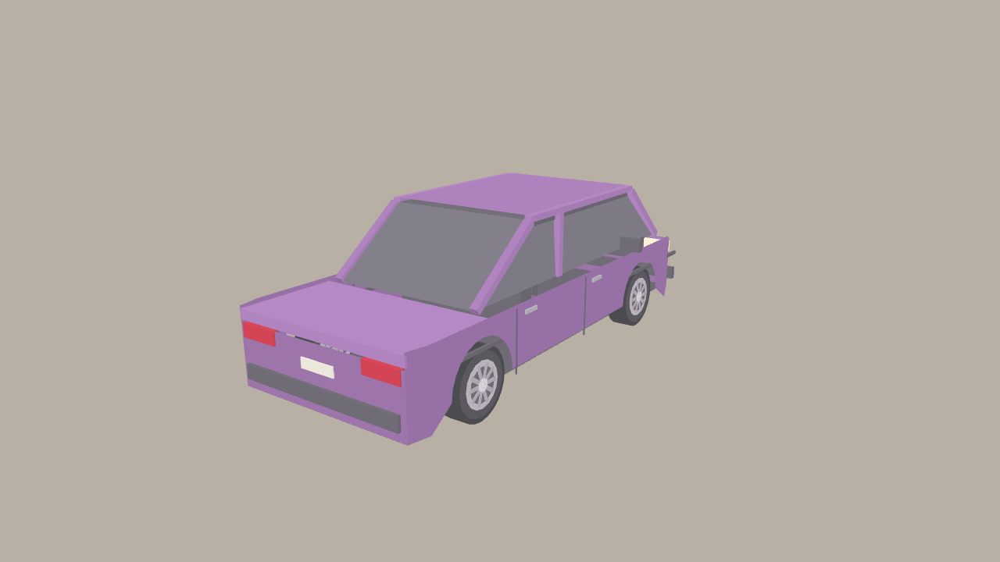

### CUV: front and rear

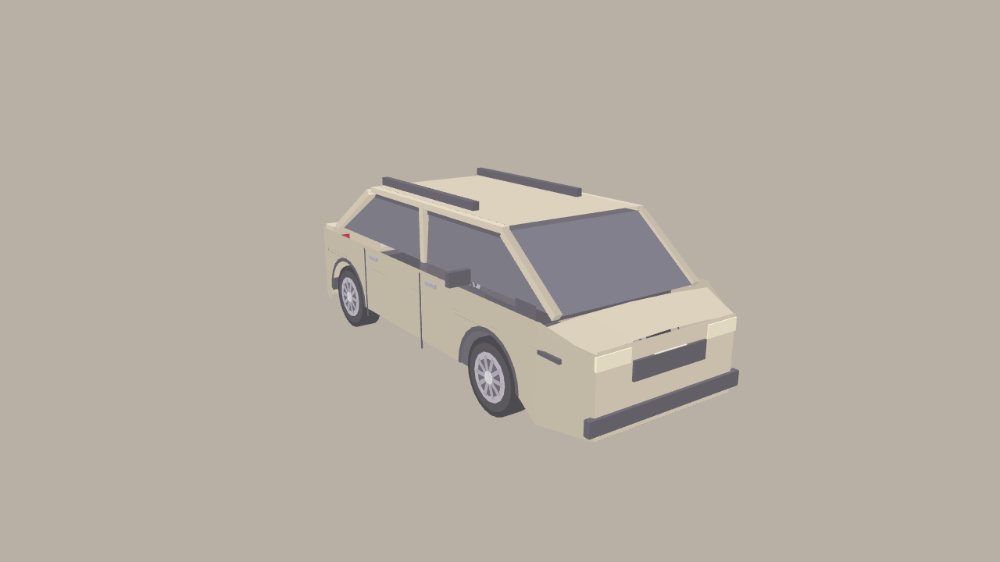

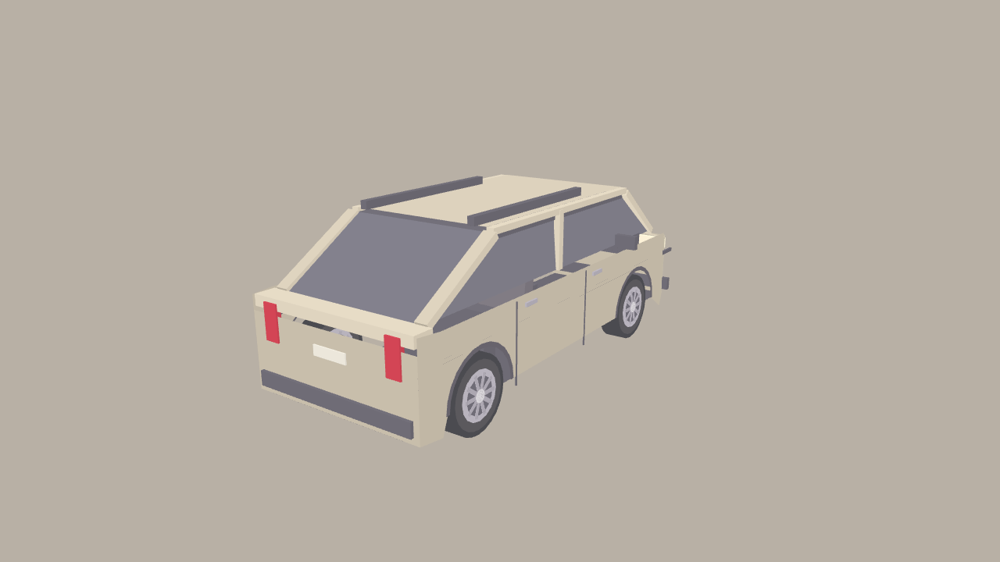

### Cockpits and mirrors

Both cockpits contain a narrowed 1.1 m dashboard and compact instrument
backing, three static instrument dials/needles and four separated indicator
lamps, pedals, a center console/storage, door panels, floor, roof lining, front
seats/headrests and a rear seat. The dial cluster sits above the wheel rim; all
16 sampled points around the steering-wheel ring, all three dials and all four
lamps remain visible from the fixed driver eye. These are static artwork, not
simulator telemetry. Application camera controls and default poses are
unchanged.
Driver-view asset captures omit the HUD overhead inset so all three dials
remain visible; the separate overhead captures are unchanged.

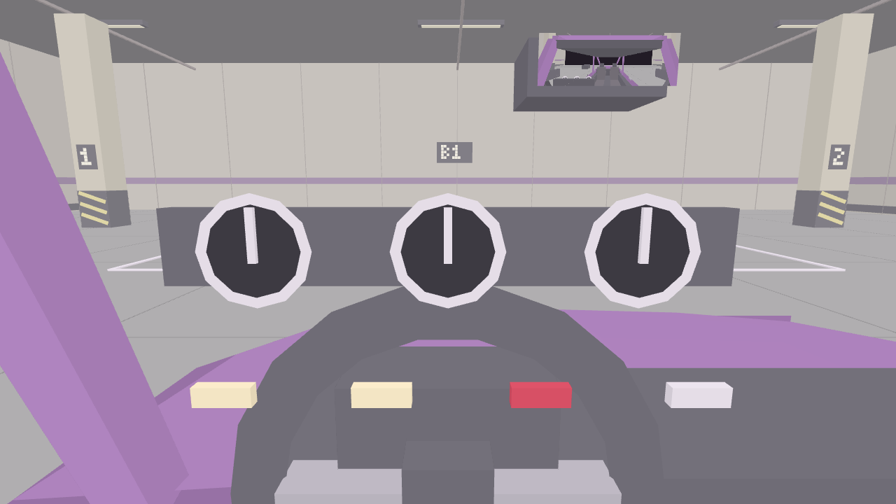

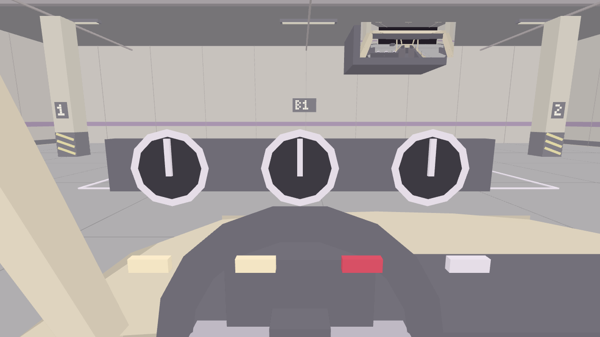

Driven-car window faces are opaque and outward-facing: exterior views show
closed windows while interior rays see the culled backfaces. These faces are
excluded from mirror renders. Stationary cars use separate double-sided
glazing. This is not a transparent-glass simulation.

Vehicle roots remain center-of-mass based, in meters, +Y up and -Z forward.
The physical profiles, eye anchors and mirror-camera anchors are unchanged:

| Vehicle | COM height (m) | `DriverEye` local (m) | `MirrorRear` local (m) | Left/right mirror local (m) |
|---|---:|---|---|---|
| Sedan | 0.52 | (-0.36, 0.60, -0.965) | (0, 0.72, -1.715) | (+/-0.96, 0.43, -0.865) |
| CUV | 0.62 | (-0.36, 0.68, -0.8462) | (0, 0.80, -1.5962) | (+/-0.965, 0.48, -0.7462) |

Mirror anchor yaw remains rear 180 degrees, left +105 degrees and right
-105 degrees. The smaller 0.07 x 0.025 m rearview **display mesh** is placed
inside the cabin, within the driver's forward view, offset from its unchanged
virtual camera by (-0.28, -0.06, +0.52) m. It is a view proxy, not a newly
calibrated optical mirror. Side displays face the driver; their virtual camera
anchors and yaw remain unchanged. Separate pale exterior reflector faces make
the side mirrors legible from outside, while housings remain behind the
driver-facing display planes.
Planar mirror surfaces have UVs and updates retain the existing 15 FPS cap.
Loaded-mesh 9 x 9 ray grids verify both side faces are unobstructed from each
fixed eye; separate projected-width and angle checks reject edge-on displays.
These checks do not establish optical calibration.

## Environments and modular objects

| Asset | Declared width x height x depth (m) | Stored triangles | Nodes / meshes | GLB bytes |
|---|---|---:|---:|---:|
| [Underground garage](../public/assets/environments/garage.glb) | 30 x 6 x 30 | 2,160 | 19 / 14 | 182,624 |
| [Urban roadside](../public/assets/environments/roadside.glb) | 50 x 3 x 32 | 1,968 | 12 / 9 | 162,796 |

Both are below the 30,000-triangle environment gate. Repeated static details
are merged into compatible batches rather than separate objects/draw calls.

### Underground garage

Concrete floor/wall joints, amethyst wall bands, bay markings, B1 and pillar
identifiers, protective pillar bases, hazard stripes, overhead pipes/supports
and bright static fixture faces make the space recognizable. Fixture faces
are geometry, not lights or an image-based lighting bake.

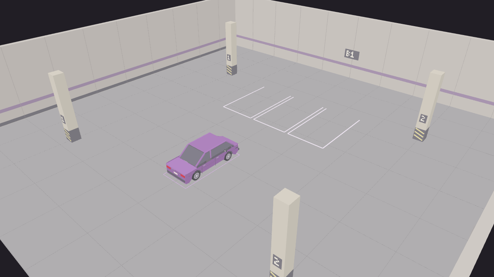

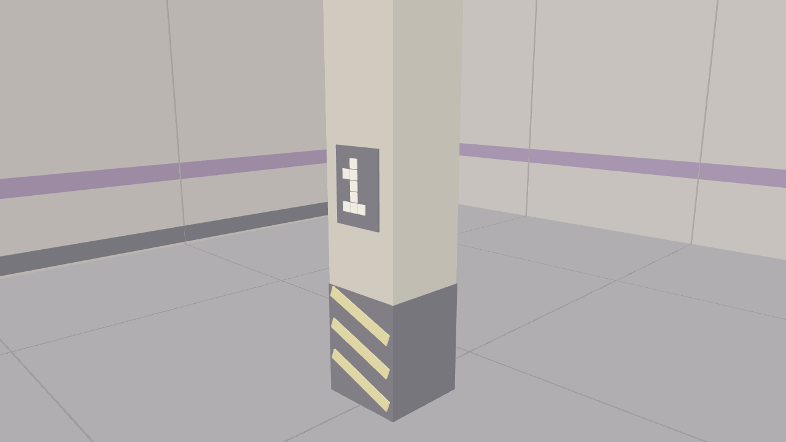

The cockpit pictures above also show ceiling fixtures and pipe runs.
All overhead details remain in `Ceiling`, excluded from the overhead camera
but retained in ordinary views.

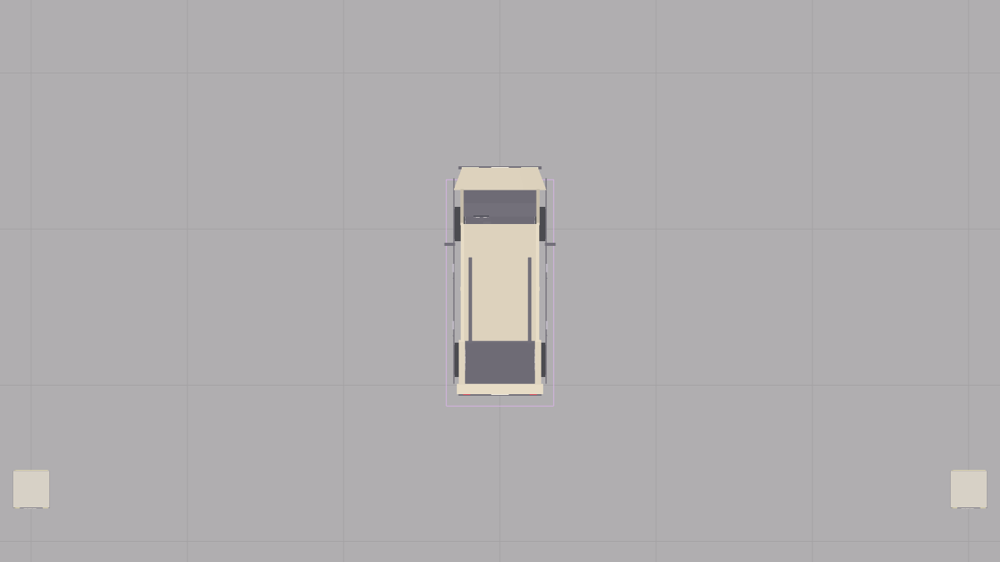

### Urban roadside

The road has an asphalt color region, lane/edge markings, sidewalk slabs,
curb joints, a concrete barrier block and detailed existing fence. Restrained
background frontages sit behind that physical fence, outside the reachable
driving surface; they do not introduce traversable solid-looking buildings.

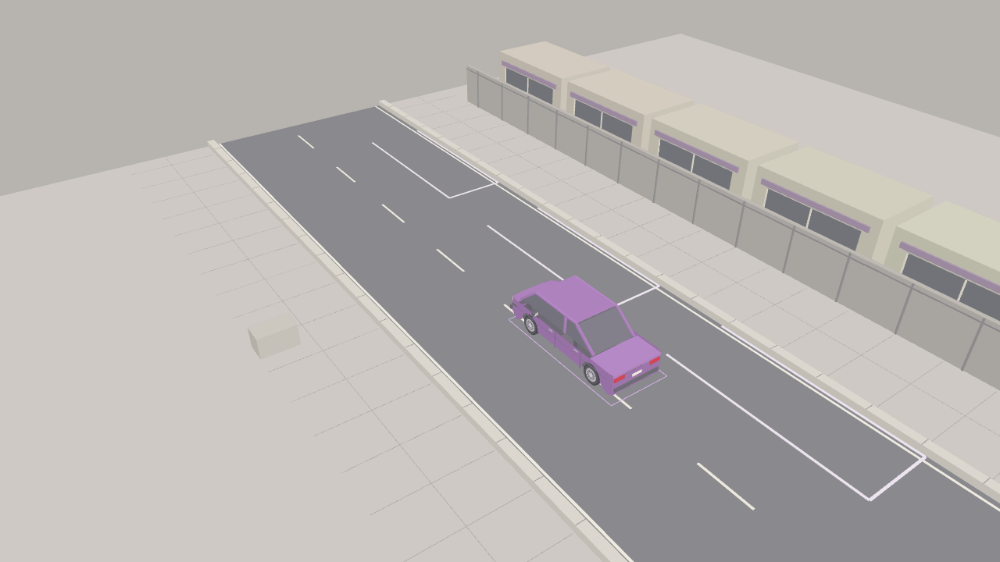

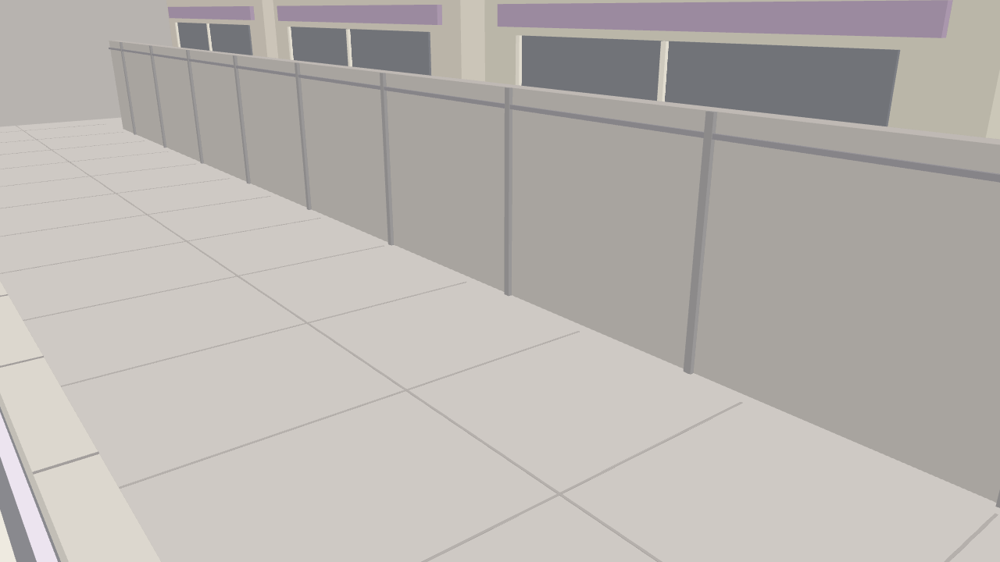

### Parked lesson cars and guidance

Every existing lesson obstacle now has a visible stationary car, reusing the
selected vehicle's exterior and wheels without its cockpit or live mirror
surfaces. Each owns cloned geometry/materials and is fitted to the exact
collider box before applying its yaw. Stationary geometry is 2,302 triangles
for Sedan and 2,422 for CUV, below the 4,000-triangle gate.

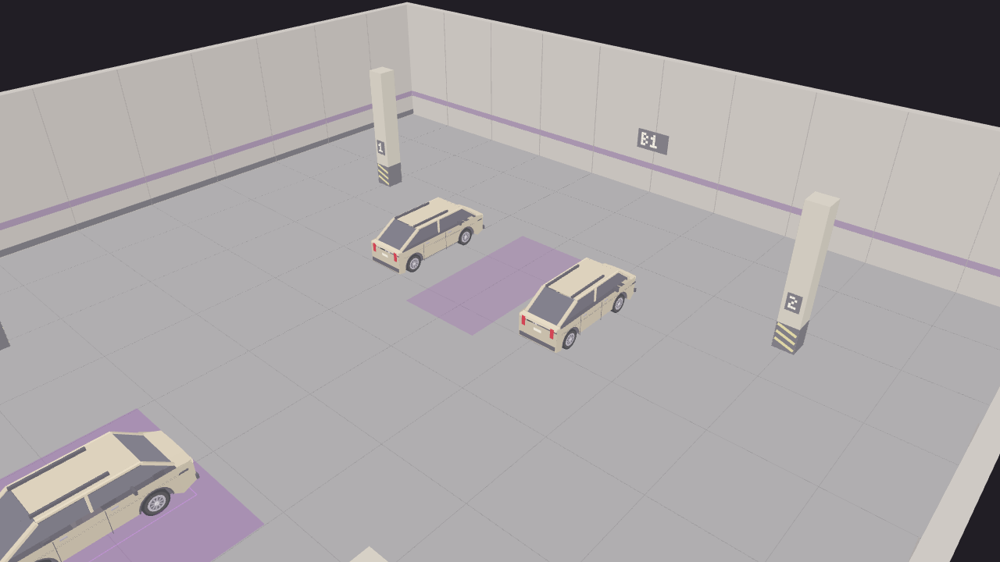

Stages 1, 2, 3 and 5 each have two parked cars; Stage 4 has one. Narrow
obstacles intentionally produce narrower visual cars to match the unchanged
training layout. Collision remains a **simple box approximation**, not
per-polygon contact with curved artwork. No physics vehicles are added.

Generic environment bay lines are hidden during lessons so they cannot
contradict lesson targets. Sandbox bay lines, target/highlight planes,
trajectory guidance and sensor overlays retain their existing behavior.

## Payload and actual rendering measurements

Only the selected vehicle/environment pair is loaded; parked cars reuse it.
All GLBs are self-contained and use no external image/buffer resources.

| Selected pair | Uncompressed bytes |
|---|---:|
| Sedan + garage | 422,872 |
| Sedan + roadside | 403,044 |
| CUV + garage | 431,084 |
| CUV + roadside | 411,256 |

All pairs are below the 5,000,000-byte gate.

The test fixture measures the real view pipeline at a settled spawn with
driver view, trajectory and overhead enabled, 1280 x 720. Counters are reset
and read **around each actual render**, not once across unrelated passes.
The table reports an auxiliary-update frame at 80 ms:

| Scene | Main calls / triangles | Three mirror calls | Overhead calls | Composite calls | Full-frame calls |
|---|---:|---|---:|---:|---:|
| Sedan + garage | 28 / 3,512 | 36 + 19 + 19 | 41 | 1 | 144 |
| Sedan + roadside | 24 / 3,332 | 34 + 19 + 19 | 41 | 1 | 138 |
| CUV + garage | 28 / 3,644 | 35 + 19 + 19 | 40 | 1 | 142 |
| CUV + roadside | 24 / 3,464 | 33 + 19 + 19 | 40 | 1 | 136 |
| Stage 1, CUV | 73 / 8,388 | 35 + 21 + 21 | 40 | 1 | 191 |
| Stage 2, CUV | 24 / 3,480 | 78 + 21 + 21 | 40 | 1 | 185 |
| Stage 3, CUV | 36 / 4,550 | 57 + 20 + 29 | 64 | 1 | 207 |
| Stage 4, CUV | 25 / 3,492 | 59 + 21 + 24 | 41 | 1 | 171 |
| Stage 5, CUV | 27 / 3,576 | 55 + 20 + 29 | 60 | 1 | 192 |

The gates are <=100 **main-pass** calls in sandbox and <=140 in lessons,
not limits on the sum of all camera passes. These sampled poses pass; their
full-frame costs are explicitly larger. A frame at 20 ms has no mirror
update, preserving the existing rate cap. Counts are not an FPS benchmark
or a worst-case guarantee for every driving pose.

## Reproduce and inspect

```powershell
node tools\generate-assets.mjs
npx vitest run src\world\generate-assets.test.mjs src\world\assets.test.mjs
npx playwright test phase-8-assets.spec.ts
```

Editable artwork is in `tools\asset-designs`; generic geometry helpers and the
GLB writer are separate. Browser captures are written to test artifacts, never
automatically over the committed pictures. Inspect artifacts before choosing
updated catalog images. The fixture and its capture API are test-only, not
part of the production app. See [asset pipeline](asset-pipeline.md).

## Verification limits

For the Issue #12 redesign, 518 tests across 31 files, 67 focused
generator/loader tests, typecheck, production build and all 10 Chromium Phase 8
asset-render cases passed, including the five parked-lesson scenes. The
focused selection overlaps the full suite. Vite reports a 766.91 kB generated
assets chunk, above its 500 kB advisory threshold. No lint script exists.

The branch includes the current Phase 7 learner experience. Its app captures
follow the real tutorial/menu/settings/briefing flow rather than bypassing it.
The independent whole-branch review found rear-side shell/trunk gaps,
edge-on or obstructed side-mirror displays, a low rearview display, and
overlapping cockpit dials/lamps. Loaded-GLB ray, color and projection
regressions reproduced the visibility failures; revised geometry and spacing
now pass those checks.

Captures used Chromium 156.0.8078.4 with ANGLE Vulkan **SwiftShader**, not the
host's hardware GPU. App screenshots are 1920 x 1080; asset captures are
1280 x 720. The 2560 x 1440 benchmark was attempted with honest metadata,
but the host display was 144 Hz, so the existing 60 Hz eligibility gate
rejected it before measurement. No cases or FPS were measured.

The approved 1440p60 target (p95 <=17.5 ms, mean >=57 FPS, zero loss) is
**unverified**. These runs used Node 24.13.1, below the declared 24.15.0
floor for that major. Supported-Node, reference/minimum-PC, physical wheel,
manual labeled mirror-landmark, vehicle-clearance, route and instructor
validation remain pending. Artwork and software checks do not establish
real-world training readiness.

## Provenance and license

Original geometry, palette choices and compositions were authored for
Park-Core by Park-Core contributors. No third-party artwork was imported;
no manufacturer identity is claimed. Regeneration is deterministic, and
license/attribution metadata is embedded in each GLB.

New creative definitions, GLBs and artwork-focused pictures are
[CC BY-NC 4.0](../public/assets/LICENSE): freely share/adapt for
**noncommercial** purposes with attribution, a license link and an indication
of changes. Attribute "Park-Core contributors, Park-Core Phase 8 original
artwork" and link the [source repository](https://github.com/nguyenviettung7691/park-core).
See the [creative-source notice](../tools/asset-designs/LICENSE) and
[picture notice](images/phase-8/LICENSE).

Application code, generic generation mechanics and technical documentation
remain [MIT](../LICENSE). The new artwork is source-available, **not
OSI-open-source** because commercial use is restricted. Existing MIT grants
on earlier versions remain valid; dependency/tool licenses are unchanged.
